# 20261120_bangkok

<html lang="ja" data-loaded="false" data-scrolled="false" data-spmenu="closed">
<head>

<meta charset="UTF-8">
<meta http-equiv="Content-Type" content="text/html; charset=UTF-8">
<meta http-equiv="X-UA-Compatible" content="IE=EmulateIE10" />
<meta http-equiv="X-UA-Compatible" content="IE=edge">

<meta name="viewport" content="width=device-width, initial-scale=1.0">

<!--ここから上はお決まりの定型文です-->

<!--ここからが表現の書式などを決めるcssという部分-->

<link href="https://cdnjs.cloudflare.com/ajax/libs/lightbox2/2.7.1/css/lightbox.css" rel="stylesheet">

</head>

<body>
    
<!--
    
<a href="https://peyng.github.io/restart/">前回までの記録</a>><a>今回2026,05,28</a>

-->

モバイル端末をお使いの場合は、画面を横向きにすると
背景画像の横方向がご覧頂けます。

<!--ここ上は、ほぼそのまま使います！-->

<!--QRコードの挿入例-->

 QR for Access

<marquee direction="left" scrollamount="20" width="30%">(^_^)/~alis</marquee>

<!--流れ文字の挿入例-->
<h1><marquee behavior="left">!!! 2026/11/20、朝のお花からパタヤに移動、シャツ製造の工場経営するお宅で夕食してカラオケまで  !!!</marquee></h1>

<!--ここから下が、本体部分-->

<h2>2026/Nov/19日、朝のお花がニッコリこんにちは</h2>
<a href="20261120_00001.jpeg" target="_blank">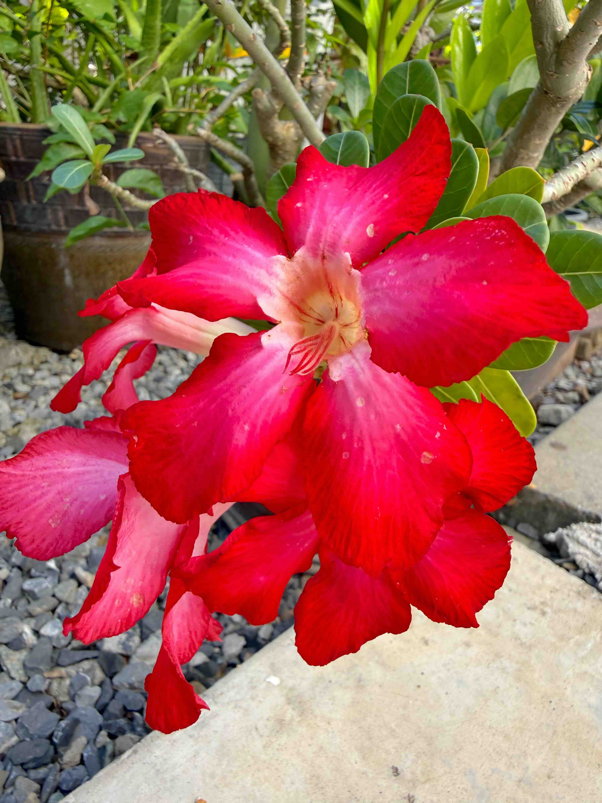</a>

<h2>タクシーでバンコクからパタヤーに移動します</h2>
<a href="20261120_00002.jpeg" target="_blank">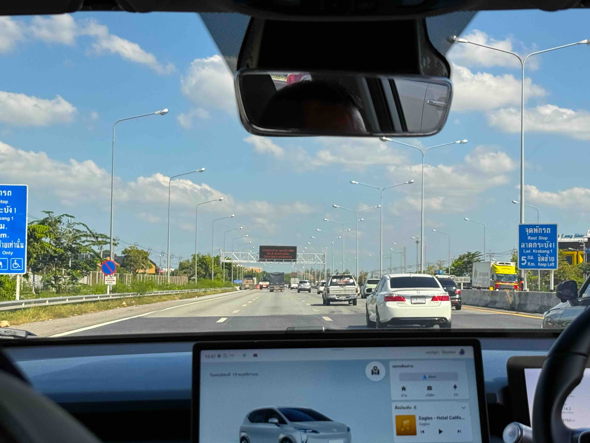</a>
<a href="20261120_00003.jpeg" target="_blank">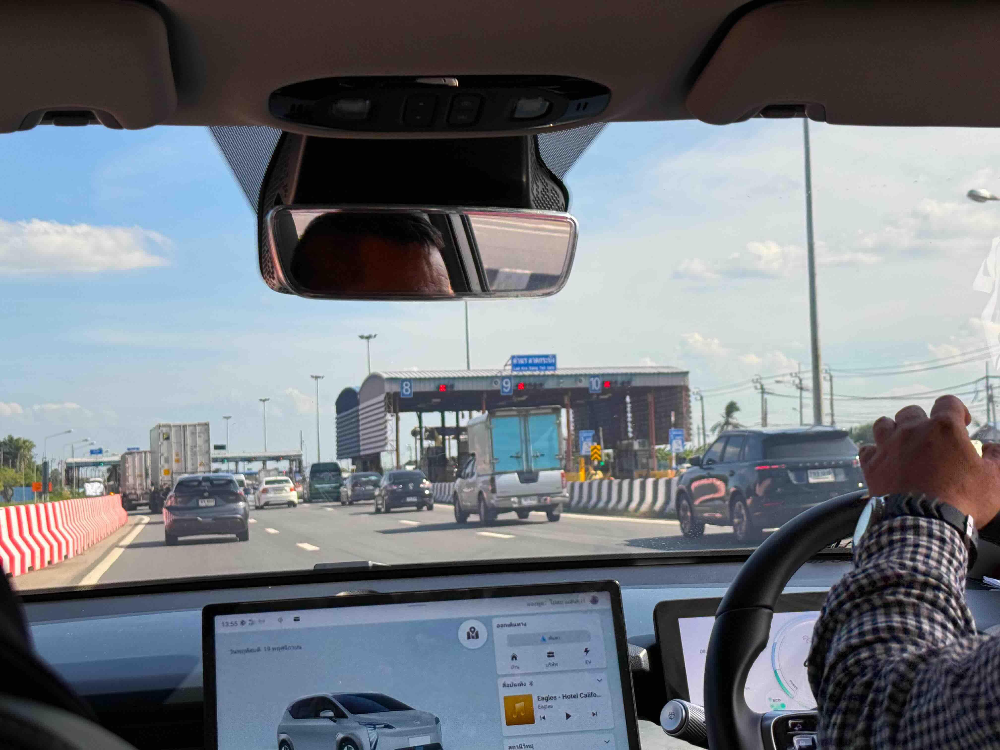</a>

<h2>有料区間に入ります</h2>
<a href="20261120_00004.jpeg" target="_blank">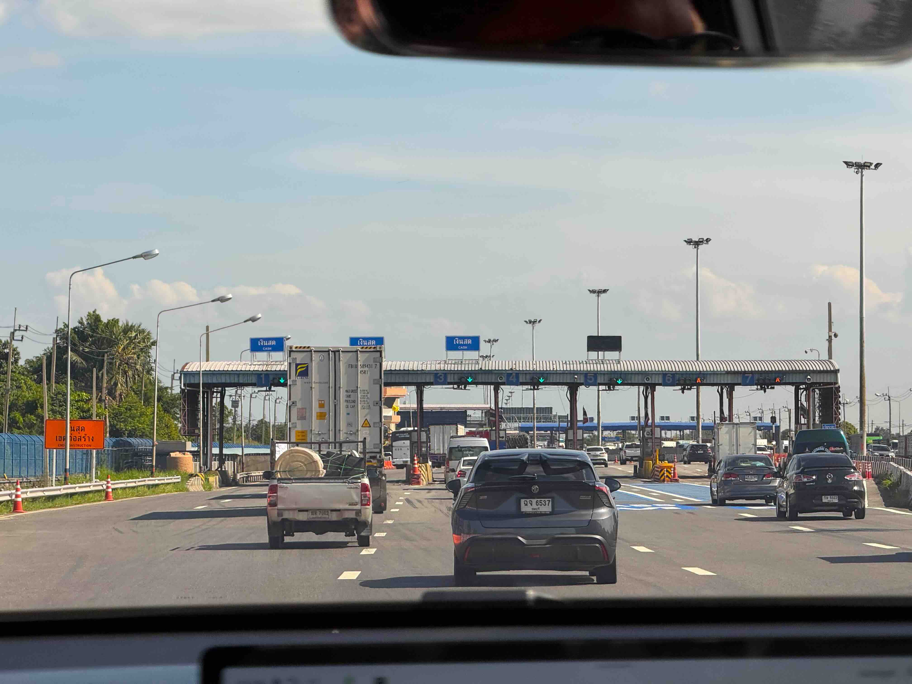</a>

<h2>バンコクエリアを抜けると、一面の大平原</h2>
<a href="20261120_00005.jpeg" target="_blank">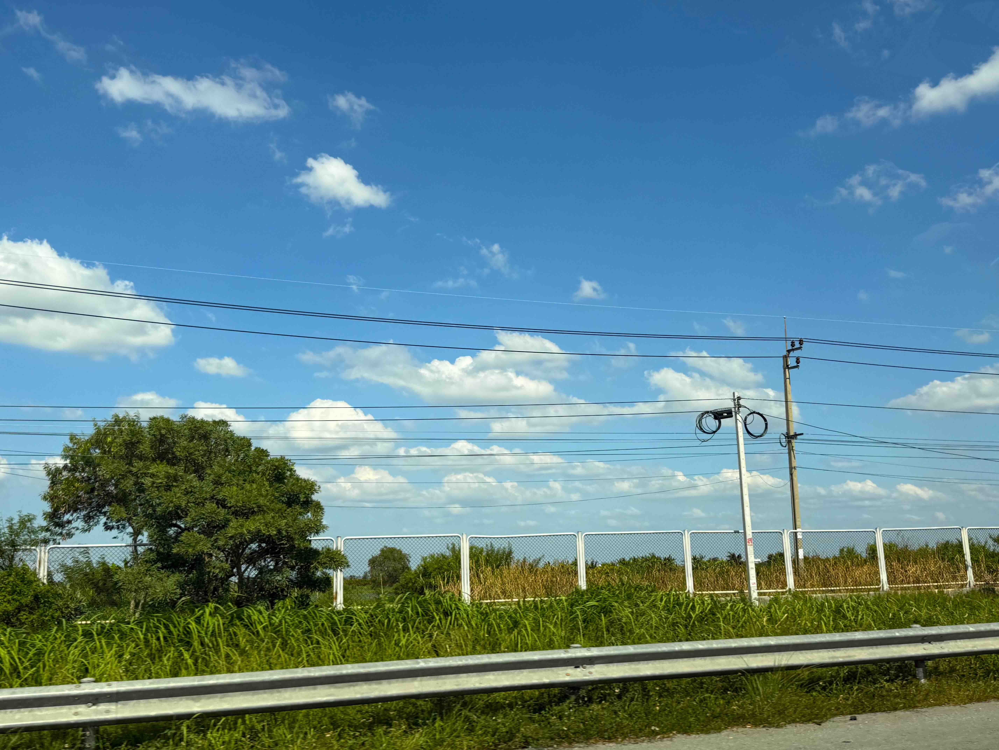</a>

<h2>正面に山々が見えてきます、バンコクとパタやーの中間地点に広がる山岳地帯</h2>
<a href="20261120_00006.jpeg" target="_blank">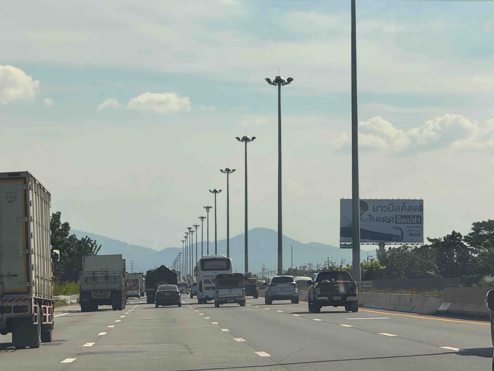</a>

<h2>雇用対策で外国機票を呼び込む産業地帯、DENSOの看板も見えました</h2>
<a href="20261120_00007.jpeg" target="_blank">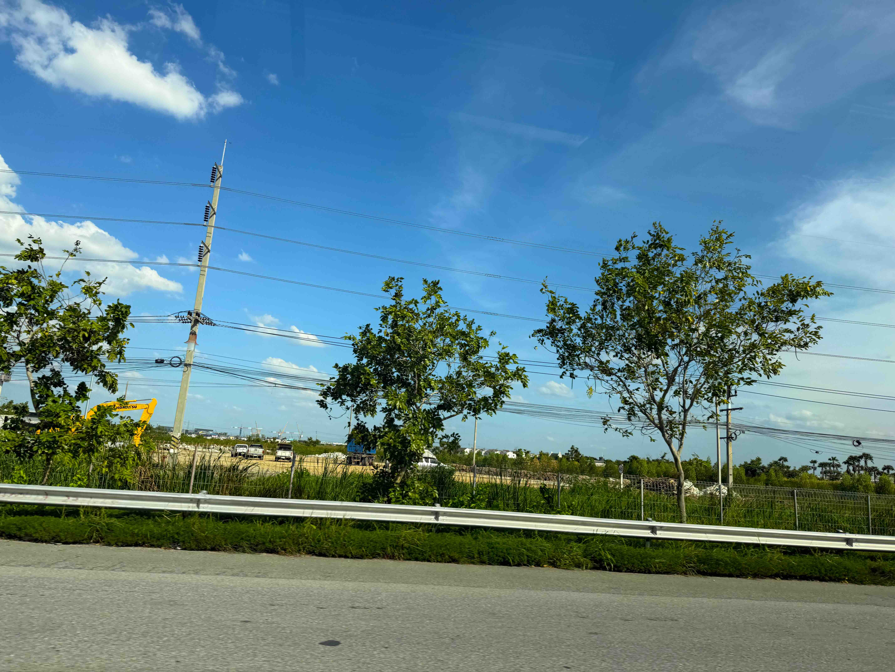</a>

<h2>先ほどの山々が近づきます、チョンブリーと言われるエリア</h2>
<a href="20261120_00008.jpeg" target="_blank">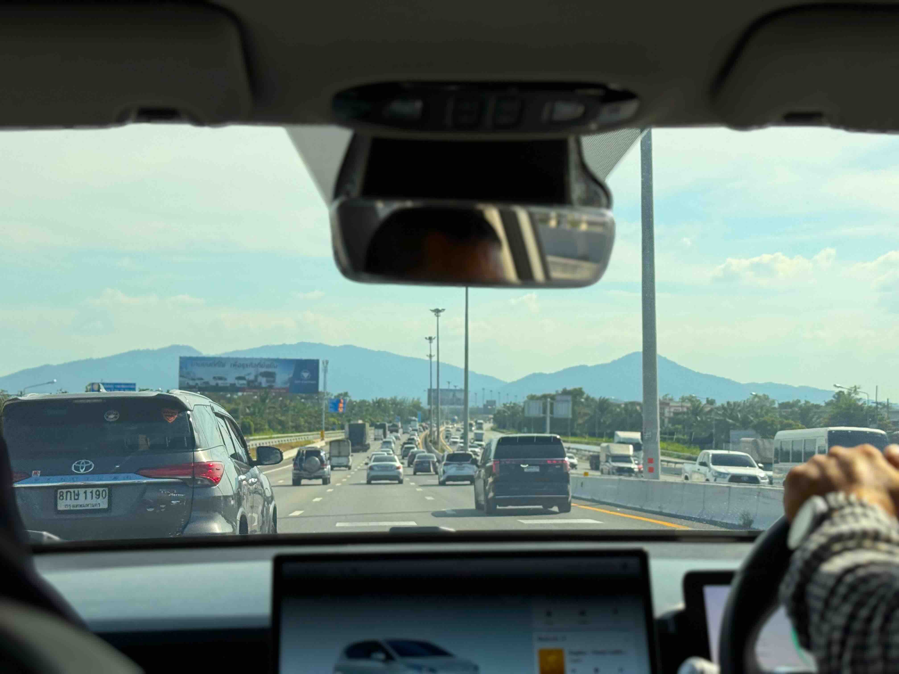</a>
<a href="20261120_00009.jpeg" target="_blank">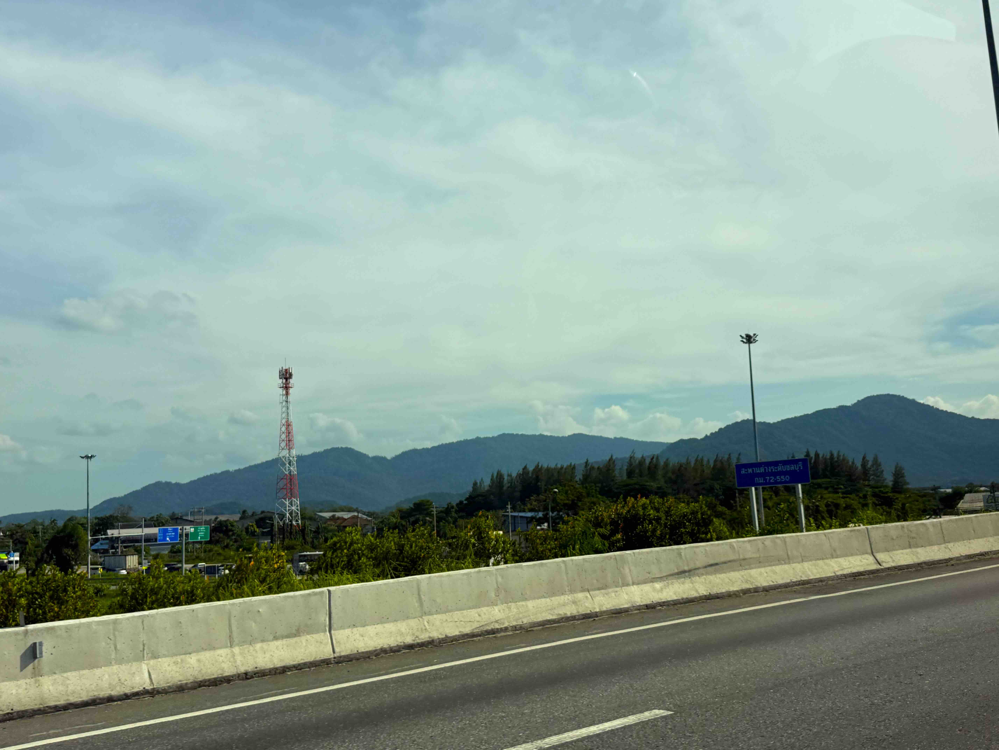</a>

<h2>山々の西側を通過</h2>
<a href="20261120_00010.jpeg" target="_blank">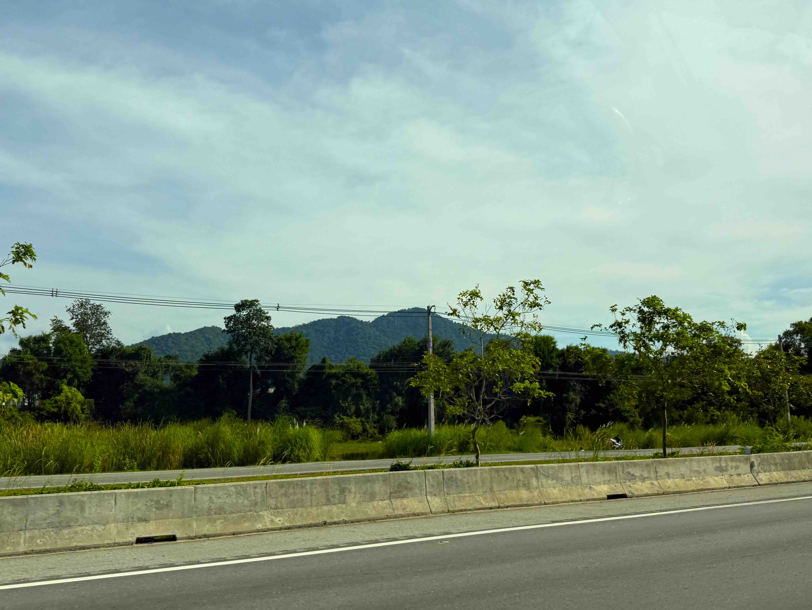</a>

<h2>いよいよパタヤーエリア</h2>
<a href="20261120_00011.jpeg" target="_blank">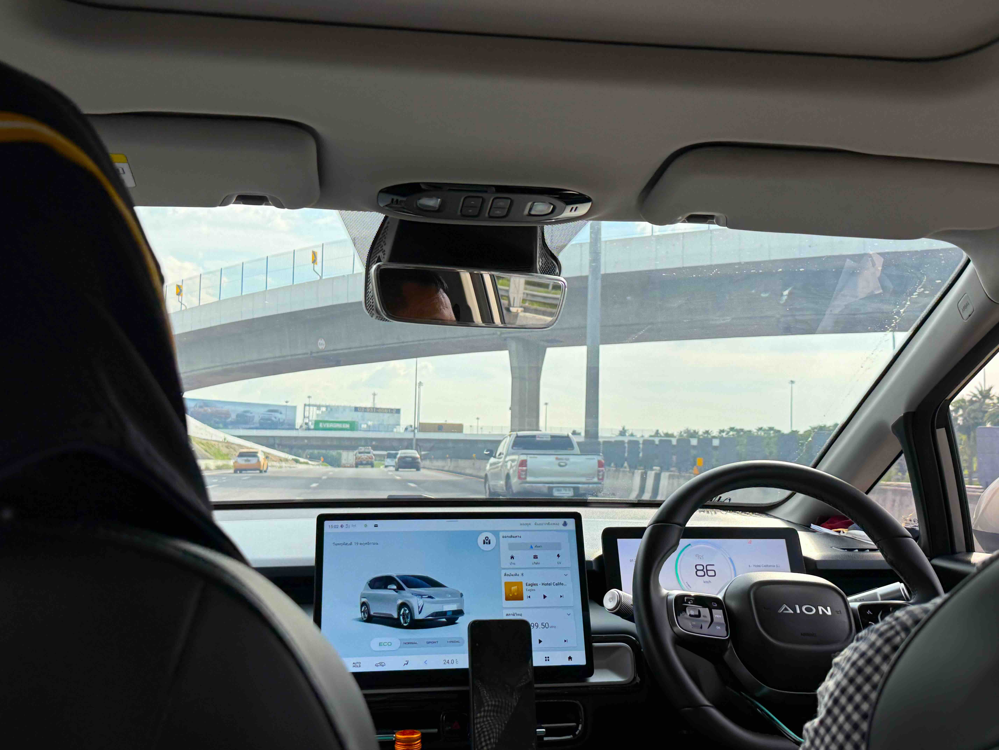</a>

<h2>料金所でお金を払います</h2>

<h2>105バーツ・・・500円弱</h2>

<h2>パタヤーの高層ビル群が見え始めます</h2>

<h2>大型バイクが元気に追い抜いていきました、ハーレークラスのアメリカンに乗るのは、ほとんどが白人さんなどの外国人</h2>

<h2>タクシーでの移動経路はこんなコース、2時間弱で着きました</h2>
<a href="20261120_00001.png" target="_blank">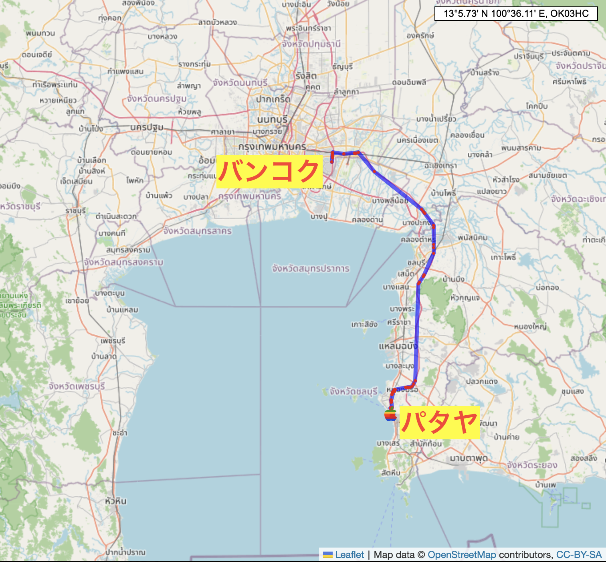</a>

<h2>高速を出て街におります</h2>

<h2>パタヤー市街地</h2>

<h2>訪問先ではネコちゃんがお出迎え</h2>

<h2>デスクトップ機が立ち並ぶ、大きな事務机</h2>

<!--

-->

<h2>小学生の男の子がIT担当、スマホをWi-Fiに繋いでもらいます</h2>

<h2>晩御飯をご馳走になりました、盛大です</h2>

<h2>屋内には別のネコちゃん</h2>

<h2>このお宅はシャツの製造工場を営んでいます</h2>

<h2>工場の屋根の上にはお月様が見えます</h2>

<h2>月齢9.2日、なかなか上手く撮れません</h2>

<h2>西の空の雲が染まりました</h2>

<h2>玄関先ではEVを充電中</h2>

<h2>晩御飯の大人数感</h2>

<h2>猫ちゃんもおとなしく馴染んでます</h2>

<h2>食後はカラオケ</h2>

<h2>カラオケの盛り上がりは絶好調</h2>

<iframe width="560" height="315" src="https://www.youtube.com/embed/ppqZmsheMTw?si=9aRPlRBRy2xuQZRI&autoplay=1&mute=1&loop=1&playlist=ppqZmsheMTw" title="YouTube video player" frameborder="0" allow="accelerometer; autoplay; clipboard-write; encrypted-media; gyroscope; picture-in-picture" allowfullscreen></iframe>
    

<h2>最初の猫ちゃんはまだ6ヶ月の子ねこ</h2>

<h2>最後はタクシーで移動して終わり</h2>

<h2>Moon age</h2>
    <h2>
<a href="https://starwalk.space/ja/moon-calendar" target="_blank">Moon age Link</a>
</h2>

<h2>今日のBGMは、バッハ名曲集｜時を超えて響く、美しいクラシック20選J.S. Bach – Masterpieces Collection | The Best of Bach</h2>

<iframe width="560" height="315" src="https://www.youtube.com/embed/AOZR1lzYbw8?si=BR8TPH6vS7zhySdU" title="YouTube video player" frameborder="0" allow="accelerometer; autoplay; clipboard-write; encrypted-media; gyroscope; picture-in-picture; web-share" referrerpolicy="strict-origin-when-cross-origin" allowfullscreen></iframe>
    

   
<h2>2026Nov20、朝のお花からパタヤに移動、シャツ製造の工場経営するお宅で夕食してカラオケまででした Thank you for reading this far.</h2>
<!--
     
<h2>
<a href="https://torokoid.github.io/Mashiko_himawari_3/" target="_blank">クリックでメニューページに戻ります</a>
</h2>
-->

   

<!-- hitwebcounter Code START -->
<a href="https://www.hitwebcounter.com" target="_blank">

you are visitor The numbers are cumulative for the Bangkok ＆ Utsunomiya series websites launched since 2025 August 1st.
</a>   

<!--本体はここまで-->
    

<!--画面に空白地帯を作って、背景が見えるようにしています-->

<!-- フッタ -->
<footer>

Copyright 2026/11/20 alis

</footer>

<!--HPにさまざまなJavaScriptを呼び込むための書式-->

    
    </body>
    
</html>
